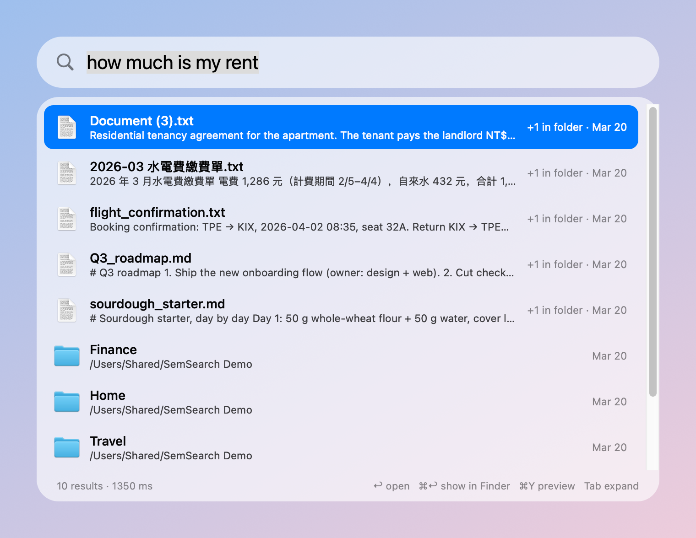
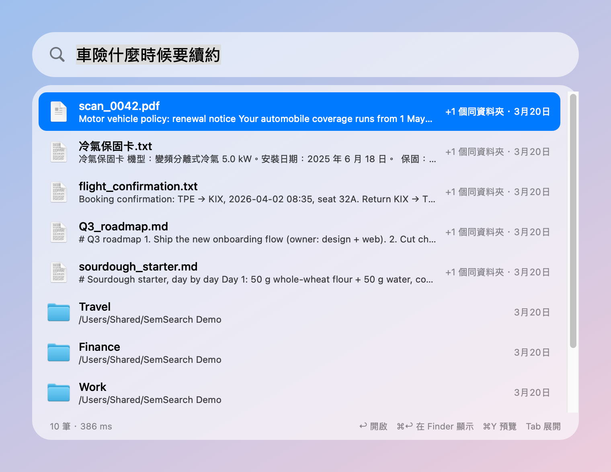

# SemSearch

**English** · [繁體中文](README.zh-TW.md)


**Find files and apps on your Mac by describing them, in any language.**

Spotlight only finds a file when you remember words from its name. SemSearch understands what
you mean, so you can find a file even when you have no idea what it is called. Everything runs
on your Mac: your files and searches never leave it.

[](https://youtu.be/FPExL5MBMQY)

**[▶ Watch the demo on YouTube](https://youtu.be/FPExL5MBMQY)** (with sound)

## What it can do

| You type | It finds | Why Spotlight can't |
|---|---|---|
| how much is my rent | a lease saved as `Document (3).txt` | “rent” is in neither the name nor the text |
| when is my car insurance due | `scan_0042.pdf`, a “motor vehicle policy” | it matches meaning, not words |
| beef noodle soup recipe | `紅燒牛肉麵.md` | English question, Chinese file |
| note-taking app | Notes, Goodnotes, OneNote | it knows what each app is for |
| trash | the Trash | places work too |

| An English question finds a lease named `Document (3).txt` | A Chinese question finds an English PDF (Chinese interface) |
|---|---|
|  |  |

*(The video and screenshots use fictional example files from the [`demo/`](demo) folder.)*

## Install

**You need** a Mac with Apple silicon (M1 or newer), macOS 13 or later, and about 2 GB of free space.

**With [Homebrew](https://brew.sh)** (one line; no Xcode tools needed on macOS 14 or later):

```bash
brew install kuanlinb/tap/semsearch && semsearch-install
```

**Or from source** (needs `xcode-select --install` once):

```bash
git clone https://github.com/kuanlinb/semsearch.git
cd semsearch
./install.sh
```

Then **click “Allow”** when macOS asks whether SemSearch may read your Documents, Desktop and
Downloads.

That's it. SemSearch now starts automatically when you log in. What happens next:

- The first time, it downloads the language model (about 2.3 GB, only once).
- **File names are searchable within minutes** (about 15 minutes for 165,000 files). Reading the
  text inside every document takes longer, from minutes for a small folder to about 2 hours for
  165,000 files; you can search while it works.
- Updating: `brew upgrade semsearch && semsearch-install`, or `git pull && ./install.sh`.
- Removing: `semsearch-uninstall` (then `brew uninstall semsearch`), or `./uninstall.sh`.
- From source, keep the `semsearch` folder where it is: the app runs from it.

> If the installer says Python is too old, install a newer one with `brew install python`
> (or install [uv](https://github.com/astral-sh/uv)) and run `./install.sh` again.

## How to use

Press **⌥ Space** (Option + Space), type what you are looking for in your own words, and press **↩**.

| Key | Does |
|---|---|
| ↩ | Open the file or app |
| ⌘ ↩ | Show it in Finder |
| ⌘ Y | Quick Look preview |
| ⌘ C | Copy the file (paste it in Finder, or as a path in text) |
| ⌥ ⌘ C | Copy the path |
| Tab | Show the other matches from the same folder |
| Esc | Clear the search, press again to close |

**Tips**

- Describe it the way you would to a friend: *“the slides about attention from class”*,
  *“receipt for the new laptop”*.
- Add a type word to narrow it down: *“… pdf”*, *“… slides”*, *“… folder”*, *“… app”*.
- Ask in any language; the file can be in another one.
- Want ⌘Space? It can [replace Spotlight's shortcut](docs/troubleshooting.md#use-space-instead-of-spotlight); Spotlight keeps the 🔍 key.
- ⌥ Space does nothing? Another app is using it: pick another shortcut under **Shortcut**, from the menu-bar icon or the gear in the search box ([more](docs/troubleshooting.md#space-does-nothing)).
- Also available from the menu-bar icon, in a browser at `http://127.0.0.1:8799`, and in
  Terminal as `ss your question`.

## Features

- **Reads inside your files**: PDF, Word, PowerPoint, Excel, Markdown, plain text, notebooks, and
  the text in screenshots and scanned PDFs.
- **Finds apps by what they do**: “take a screenshot” finds Screenshot, “video call” finds FaceTime.
- **Any language**: ask in Chinese, find an English file, and the other way round.
- **Interface in your language**: English, 繁體中文, 简体中文, 日本語 and 한국어, following your Mac.
  [Add yours](l10n/README.md).
- **Learns what you use**: files you open often move up.
- **Stays up to date**: new, edited, moved and deleted files show up in about a minute, in every folder it indexes.
- **Cloud-friendly**: files that are only in iCloud, OneDrive, Google Drive or Dropbox are found by
  name and never downloaded.
- **Private**: runs entirely on your Mac. An optional [GPU reranker](remote/README.md) on another
  machine of yours can sharpen the ranking.

## Learn more

- [Configuration](docs/configuration.md): add folders, exclude paths, turn OCR off, change the port
- [How it works](docs/how-it-works.md): architecture, the search pipeline, how the model was chosen
- [Limitations, uninstall and development](docs/troubleshooting.md)
- [Security](SECURITY.md) and [changelog](CHANGELOG.md)

**Contributions are welcome**, from translations to app descriptions: see [CONTRIBUTING.md](CONTRIBUTING.md).

## License

MIT, see [LICENSE](LICENSE).
