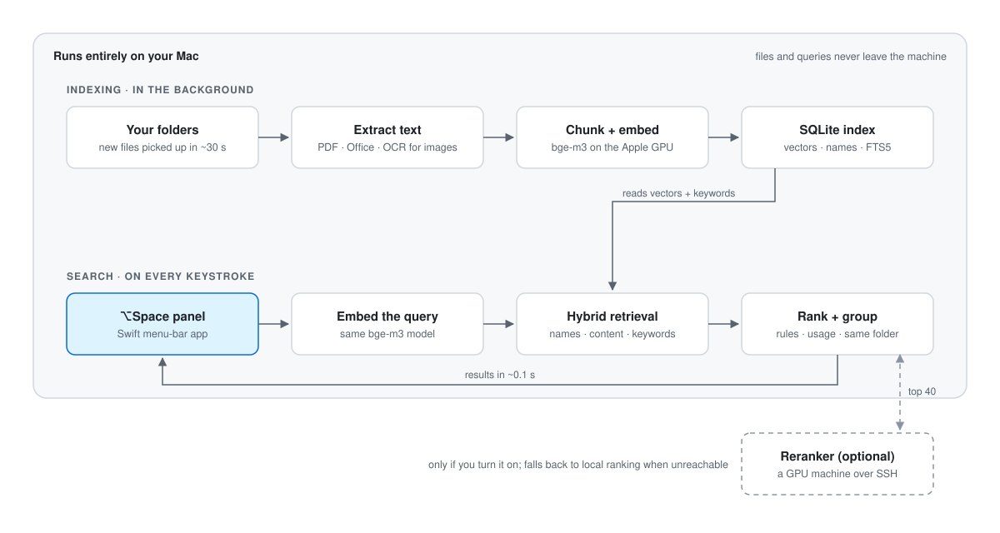
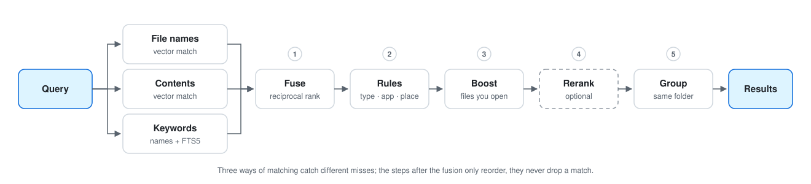

# How it works

[← Back to README](../README.md)

<picture>
  <source media="(prefers-color-scheme: dark)" srcset="architecture-dark.svg">
  
</picture>

Every search runs these steps:

<picture>
  <source media="(prefers-color-scheme: dark)" srcset="search-flow-dark.svg">
  
</picture>

Where each part lives in the code:

```
indexer.py   walk folders → extract text → chunk → embed (bge-m3, int8 on ONNX Runtime) → SQLite
             phase 1: every name (fast)   phase 2: document contents (resumable)
             phase 3: OCR of images and scanned PDFs (time-boxed, resumable)
search.py    query → name vectors ┐
                   → content vectors ├─ RRF fusion → type/app/place rules → usage boost
                   → keyword index  ┘   → optional reranker → same-folder grouping → results
                                        (in-memory name index + SQLite FTS5 trigram)
server.py    keeps the model and vectors in memory; reloads after index updates;
             runs the new-file watcher and schedules index updates
mac/         Swift menu-bar app: hotkey, panel, launches and supervises the service;
             ocr.swift (Vision) and fswatch.swift (FSEvents) helpers
remote/      optional reranker service for a GPU machine
```

## Choosing the model

Measured on the author's own files (Downloads + a synced folder, ~4k files) with 25 natural
queries, about half of them asking in Chinese for English-named files. Hit@1 = the right file is
the first result.

| Embedding model | Hit@1 | Search | Indexing time |
|---|---|---|---|
| multilingual-e5-small (118M) | 9/25 | 11 ms | 1× |
| **bge-m3 (568M, default)** | **16/25** | 22 ms | ~8× |
| Qwen3-Embedding-0.6B | 17/25 | 51 ms | ~17× |

The small model fails exactly on cross-lingual queries (“房租多少” → *Document (3).txt*). Qwen3 was one query better but twice as slow to index, so bge-m3 is the default.

bge-m3 runs quantized to int8 on ONNX Runtime by default (`tools/export_onnx.py` makes it), so the
install needs no PyTorch: about 170 MB of Python packages instead of 1 GB, and a 590 MB model
instead of 2.2 GB. On [`eval/lookalike`](../eval/lookalike) it finds the same files as PyTorch
(Hit@1 60 vs 61 of 76, Hit@3 69 for both), searches in 36 ms instead of 27 ms and uses about
150 MB less memory, but builds the index about 3× slower because it runs on the CPU. Set
`"embed_backend": "torch"` to index on the Apple GPU instead.
A cross-encoder reranker (bge-reranker-v2-m3) adds a few more hits but costs 2–4 s per query on
an M4, so it is off by default (set `"reranker": "BAAI/bge-reranker-v2-m3"` to enable it; the
panel then shows fast results first and swaps in the reranked order after you pause).

On the full home folder (165k files) the same 25 queries scored 14 at #1, 19 in the top 5 and
21 in the top 10, at about 35 ms per search.

Run the comparison on your own files:

```bash
.venv/bin/python eval/run_eval.py --queries my_queries.json --roots ~/Downloads --model BAAI/bge-m3 --tag bgem3
```

(`eval/queries.example.json` shows the format.) An existing index for the same `--tag` is reused;
add `--reindex` after changing `--roots`. `--reranker <model id>` evaluates with a reranker,
`eval/tune.py --queries … --tag …` grid-searches the fusion weights on that index, and
`eval/compare.py --queries … --tag …` compares the plain ranking with the usage boost and
same-folder grouping.
